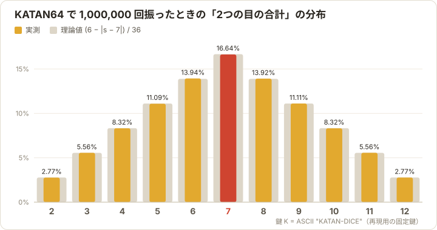
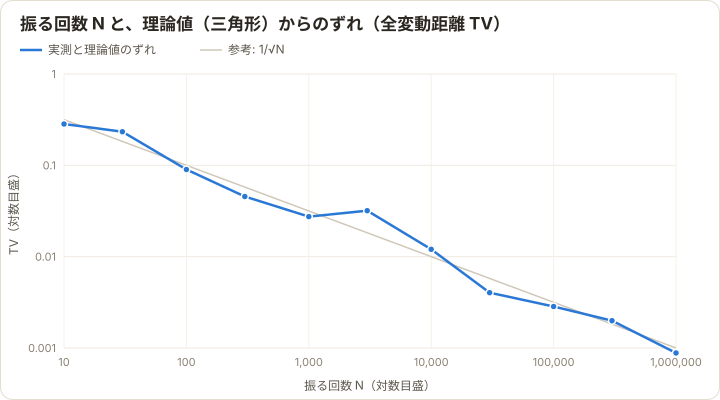

# KATAN Dice

共通鍵暗号 **KATAN64** で2つのサイコロを振る、ボードゲーム「カタン」用のWebアプリです。

**▶ https://shinya00000.github.io/KATAN-Dice/** （インストール不要・ブラウザで開くだけ）

> 名前は、ボードゲーム「カタン」と、軽量ブロック暗号「KATAN」をかけています。カタン（CATAN）の公式ツールではなく、関係者とも無関係の非公式ファンツールです。

## 概要

- ボタン1つ（または Space キー）で2つのサイコロを振ります。
- 出目は、ブラウザ内で軽量ブロック暗号 KATAN64 をカウンタモードで動かして作ります。
- **ゲーム終了後に、全ての出目が公平だったことを検証できます。** 開始時に鍵のコミットメントを表示し、終了時に鍵を公開します。
- サーバーは使いません。鍵の生成・暗号化・検証は、すべてブラウザ内で完結します。

### 主な機能

| 機能 | 内容 |
|---|---|
| 1つ戻る／サイコロをふる／1つ進む | 押し間違えたときに戻せます。戻した目は「取消」として記録されます（後述） |
| 経過時間 | 最後に振ってからの時間を表示します。長考の目安（既定2分）を過ぎると色が変わります |
| 出目の分布 | 合計（2〜12）の実際の割合を、理論値（三角形）を背景にして表示します |
| 直近の出目 | 最新14投を、左が古く右が新しい順に表示します（取り消した目は打ち消し線） |
| 暗号の可視化 | KATAN64 の内部レジスタ L1/L2 と、暗号文から出目を取り出す様子を表示します |
| 7の強調 | 盗賊が動く「7」が出ると、画面を赤く光らせて効果音を鳴らします |
| その他 | キーボード操作、連打防止、画面のスリープ防止、リロード後の復元、ライト／ダークテーマ、赤と黄のサイコロ（都市と騎士用） |

## 使い方

1. **ゲーム開始**：各プレイヤーが「合言葉」を入力し（空欄でも可）、「鍵を生成して開始」を押します。右上に表示される **コミットメント Com** を、スマホで撮影するなどして控えておきます。
2. **振る**：「サイコロをふる」ボタンか Space キーを押します。
3. **戻る／進む**：← で1つ戻る、→ で1つ進みます。
4. **ゲーム終了**：右上の ⋯ メニューから「ゲーム終了（鍵を公開）」を選ぶと、鍵が公開され、全ての出目が自動で検証されます。

| キー | 操作 |
|---|---|
| Space | サイコロをふる |
| ← | 1つ戻る |
| → | 1つ進む |

### 「1つ戻る」の扱い

- 戻すと、その目は「取消中」になり、分布や投数から外れます。「1つ進む」で元に戻せます。
- 戻した状態で「サイコロをふる」を押すと、取消中の目は **破棄（取消）** され、新しい番号 n で振ります。**同じ番号 n は二度と使いません。**
- そのため「戻してから振り直す」と別の目が出ますが、取り消した目もログに残り、終了時の検証の対象になります。取り消しを乱用すれば、後から分かります。

## 出目の決め方（確率の計算）

### 1. 鍵の生成

ゲーム開始時に、80bit の鍵 K を次のように作ります。

```
K   = trunc80( H(D‖"r:"‖r) ⊕ H(D‖"w1:"‖w1) ⊕ H(D‖"w2:"‖w2) ⊕ … )
Com = H(D‖"commit:"‖K)

H = SHA-256,  D = "katan-dice/v1/",  r = ブラウザが生成する128bit乱数,  wi = i人目の合言葉
trunc80 = 先頭10バイト
```

- 合言葉には番号を付けてからハッシュします。同じ合言葉を2人が使っても、XOR で打ち消し合いません。
- 合言葉が推測しやすくても、r が128bitの乱数なので、鍵は十分ランダムになります。

### 2. KATAN64 で暗号化する（カウンタモード）

n 回目（n = 0, 1, 2, …）の出目には、次の64bitブロックを使います。

```
平文   P = n‖j = n × 256 + j     （j = 0, 1, …：1ブロックで足りなかったときだけ増やす）
暗号文 C = KATAN64_K(P)          （254ラウンド）
```

### 3. 3bitずつ区切り、棄却法で 1〜6 にする

暗号文 C を **下位ビットから3bitずつ** 21個に区切り、0〜7 の数 c<sub>0</sub>, c<sub>1</sub>, … を作ります（最上位の1bitは使いません）。

- c が **0〜5** なら、c + 1 をサイコロの目として **採用** します。最初に採用した目が左、2つ目が右のサイコロです。
- c が **6・7** なら **捨てます**。

3bit の値は8通りあり、6つの目に均等に割り振れません。たとえば「c mod 6 + 1」とすると、1と2の目が 2/8、ほかの目が 1/8 の確率になり、大きく偏ります。棄却法なら、採用される値は 0〜5 のどれも同じ確率になります。

- C が一様にランダムなら、**各目の確率はちょうど 1/6** で、2つのサイコロは互いに独立です。
- 1ブロックで2つ揃わない確率は、(1/4)<sup>21</sup> + 21·(3/4)·(1/4)<sup>20</sup> = 4<sup>−18</sup> ≈ 1.5 × 10<sup>−11</sup> です。実際には、ほぼ毎回1ブロックで済みます。
- 2つの目が揃うまでに調べる区切りの数は、平均 2 ÷ (3/4) ≈ 2.7 個です。

> KATAN64 は鍵ごとの置換なので、同じ鍵で同じ暗号文ブロックは二度と出ません。真の乱数との違いはここだけです。この違いで見分けられる確率は、q 投に対して q²/2<sup>65</sup> 程度です。1万投でも 10<sup>−12</sup> 程度なので、無視できます。

### 4. 2つの目の合計の分布

2つのサイコロが独立に一様なら、合計 s の確率は

```
P(S = s) = (6 − |s − 7|) / 36      （s = 2, …, 12）
```

| 合計 | 2 | 3 | 4 | 5 | 6 | **7** | 8 | 9 | 10 | 11 | 12 |
|---|---|---|---|---|---|---|---|---|---|---|---|
| 確率 | 1/36 | 2/36 | 3/36 | 4/36 | 5/36 | **6/36** | 5/36 | 4/36 | 3/36 | 2/36 | 1/36 |
| % | 2.78 | 5.56 | 8.33 | 11.11 | 13.89 | **16.67** | 13.89 | 11.11 | 8.33 | 5.56 | 2.78 |

平均は 7、分散は 35/6 ≈ 5.83 で、7 を頂点とする左右対称の **三角形** になります。

## たくさん振ったときの分布

アプリと同じ KATAN64 の出目で、**1,000,000回** 振った結果です。再現できるように、固定の鍵 K = ASCII `"KATAN-DICE"`（ちょうど80bit）を使っています。



| 合計 | 2 | 3 | 4 | 5 | 6 | 7 | 8 | 9 | 10 | 11 | 12 |
|---|---|---|---|---|---|---|---|---|---|---|---|
| 理論値 % | 2.778 | 5.556 | 8.333 | 11.111 | 13.889 | 16.667 | 13.889 | 11.111 | 8.333 | 5.556 | 2.778 |
| 実測 % | 2.765 | 5.558 | 8.324 | 11.089 | 13.938 | 16.637 | 13.918 | 11.112 | 8.322 | 5.563 | 2.775 |

| 検定・統計量 | 結果 | 目安 |
|---|---|---|
| χ² 適合度（合計 2〜12） | 4.26 | 自由度10、有意水準5%の棄却限界 18.31 |
| χ² 適合度（各目 1〜6、200万個） | 5.36 | 自由度5、棄却限界 11.07 |
| χ² 適合度（目の組 (左, 右) の36通り） | 23.28 | 自由度35、棄却限界 49.80 |
| 合計の平均 | 7.0009 | 理論値 7 |
| 合計の分散 | 5.829 | 理論値 5.833 |
| 連続する合計の自己相関（ラグ1） | −0.00037 | ±2/√N ≈ ±0.002 の範囲内 |

どの検定でも、一様・独立という仮説は棄却されませんでした。ただし統計検定で分かるのは「目立つ偏りがない」ことまでです。ランダムであることの根拠は、KATAN64 が安全なブロック暗号であるという暗号学的な仮定です。

### 回数を増やすと理論値に近づく

振った回数 N ごとに、実際の分布と理論値（三角形）のずれを全変動距離 TV = ½ Σ|p(s) − q(s)| で測りました。



| N | 100 | 1,000 | 10,000 | 100,000 | 1,000,000 |
|---|---|---|---|---|---|
| 理論値とのずれ | 0.090 | 0.027 | 0.012 | 0.0029 | 0.00088 |

- ずれは、およそ 1/√N の速さで0に近づきます（大数の法則）。
- カタン1ゲームで振るのは数十〜100投程度です。この回数では、理論値から10%前後ずれるのが普通です。「今日は8が全然出ない」と感じるのは、偏りではなく単なる揺らぎです。

再現するには、次を実行します（約75秒）。

```bash
npx vite-node scripts/readme-figures.ts 1000000
```

## 公平性の検証（コミット＆リビール）

出目は鍵 K と番号 n だけで決まります。そこで、ゲーム開始時に Com = H(D‖"commit:"‖K) を表示しておき、終了時に K を公開します。

- **隠蔽性**：Com から K は分かりません（総当たりで 2<sup>80</sup> 回の計算が必要）。
- **拘束性**：後から別の鍵で同じ Com を作ることはできません。

そのため、終了後に次のことを確認できます。

1. 公開された合言葉と r から K を再計算すると一致する
2. K から計算した Com が、開始時に控えた Com と一致する
3. 取り消した目も含めて、全ての出目を K から再計算すると一致する

アプリの検証画面がこの3点を自動で確かめます。ログは JSON で保存でき、アプリを使わずに検証することもできます。たとえば Com は、公開された K（16進20桁）から次のコマンドで再計算できます。

```bash
K=ここに鍵K; (printf 'katan-dice/v1/commit:'; printf '%s' "$K" | xxd -r -p) | shasum -a 256
```

K は16進の文字列ではなく、10バイトの値としてハッシュします。

## 安全性についての注意

- **遊び用です。** 賭け事など、お金や大事なものがかかる用途には使わないでください。
- **鍵はブラウザの localStorage に保存しています**（リロードしても続けられるようにするため）。開発者ツールで鍵を見れば、この先の目が分かります。コミットメントで防げるのは「出目を変えること」で、「予測すること」は防げません。全員が同じ画面を見ている前提の設計です。
- 乱数 r はアプリが合言葉の入力後に生成します。そのため「アプリのコードが改ざんされていない」ことが前提です。
- KATAN64 は鍵長が80bitの軽量暗号です。全254ラウンドに対する実用的な攻撃は知られていませんが、現代の標準的な暗号（128bit以上）より安全性の余裕は小さめです。派生版の KTANTAN は鍵スケジュールの弱さから攻撃が進んでいるため、このアプリでは使っていません。

## 実装の検証

- KATAN64 の実装は、設計者の参照実装 [`katan.c`](https://www.cs.haifa.ac.il/~orrd/KATAN/katan.c) と照合しました。
  - 参照コードの `test_values()` が出力する6件（KATAN32/48/64 × 2）が完全に一致
  - ランダムな鍵・平文200件で、暗号化・復号とも完全に一致
  - 定数 IR は、8bit LFSR から生成した列が参照コードの表と一致
- `npm run vectors` で、参照コードと同じ形式のテスト値を出力できます。
- ユニットテストは41件あり、KATAN・出目の取り出し・戻る／進む・鍵生成・検証・保存・表示を確かめています。

## 開発

```bash
npm ci          # 依存パッケージのインストール
npm run dev     # 開発サーバー（http://localhost:5173）
npm test        # テスト（Vitest）
npm run build   # dist/index.html（HTMLファイル1つ）を生成
```

| スクリプト | 内容 |
|---|---|
| `npm run vectors` | KATAN のテスト値を、参照コードと同じ形式で出力 |
| `npx vite-node scripts/readme-figures.ts [回数]` | このREADMEのグラフ（`docs/images/distribution.svg`・`convergence.svg`）と統計量を生成 |
| `npx vite-node scripts/og-image.ts` | LINEなどで共有したときのプレビュー画像（`public/og-image.png`、1200×630）を生成（Google Chrome が必要） |

`main` ブランチにプッシュすると、GitHub Actions がテスト・ビルドを行い、GitHub Pages に公開します（[`.github/workflows/pages.yml`](.github/workflows/pages.yml)）。

### ファイル構成

```
src/
  crypto/katan.ts    KATAN32/48/64（参照実装 katan.c からの移植）
  crypto/bytes.ts    16進・バイト列・SHA-256
  core/dice.ts       カウンタモードと棄却法による出目の生成
  core/keygen.ts     鍵の導出とコミットメント
  core/history.ts    戻る／進む／取消の状態遷移
  core/game.ts       ゲームの状態・検証・保存形式
  core/stats.ts      理論分布と集計
  ui/views.ts        サイコロ・グラフ・暗号の可視化（描画）
  main.ts            画面の制御
tests/               ユニットテスト
scripts/             テスト値・実験・READMEの図・プレビュー画像の生成
docs/images/         READMEの図と、プレビュー画像の元のSVG
public/              リンクプレビュー画像（og-image.png）
```

## 参考文献

- C. De Cannière, O. Dunkelman, M. Knežević, “KATAN and KTANTAN — A Family of Small and Efficient Hardware-Oriented Block Ciphers,” *CHES 2009*, LNCS 5747. [doi:10.1007/978-3-642-04138-9_20](https://doi.org/10.1007/978-3-642-04138-9_20)
- 参照実装：https://www.cs.haifa.ac.il/~orrd/KATAN/katan.c
